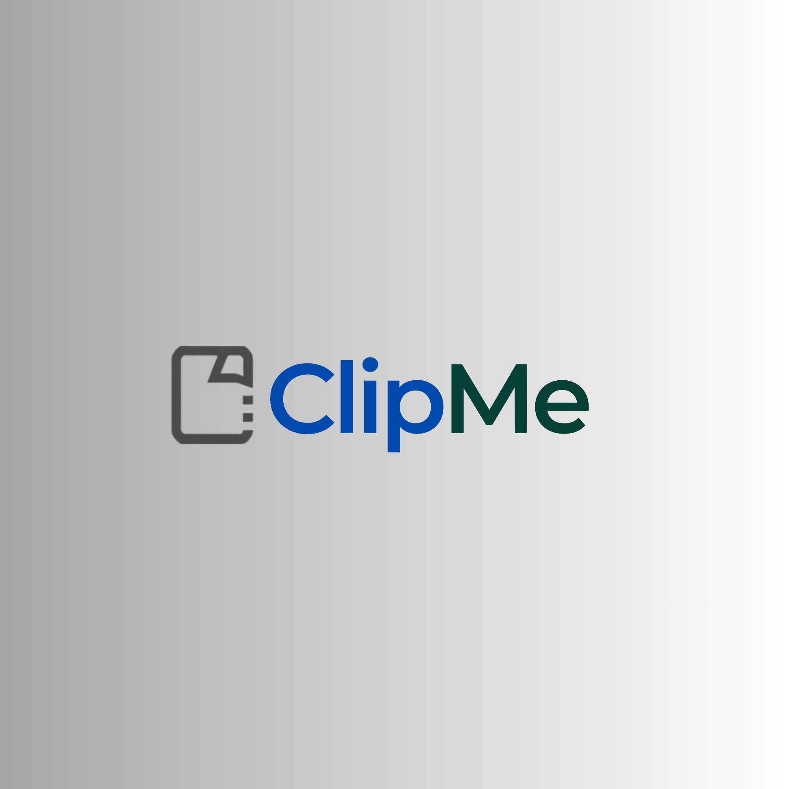

  

 

ClipMe is a clipboard extension app for macOS.

__Website__: <https://clipme-app.com> · __Download__: [latest release](https://github.com/your-org/ClipMe/releases/latest)

ClipMe is an independent fork of [Clipy](https://github.com/Clipy/Clipy) (which is
itself based on [ClipMenu](https://github.com/naotaka/ClipMenu)), distributed under the
MIT License. See [Attribution](#attribution) below.

---

__Requirement__: macOS 13 Ventura or later

> [!NOTE]
> ClipMe ships as a Universal 2 binary and runs natively on both Apple silicon (arm64,
> M1 or later) and Intel (x86_64) Macs, so no Rosetta translation is required on Apple
> chips while Intel Macs remain fully supported for backward compatibility.

### Development Environment
* macOS 26 Tahoe
* Xcode 26.5

### How to Build
macOS checks Accessibility permission by the app's code signature. If ClipMe is built without a stable signing certificate, macOS may ask for Accessibility permission again for every build.

#### Build for ad-hoc usage
1. Open `ClipMe.xcodeproj` in Xcode.
2. Switch to ad-hoc build mode:
    1. Open `Configurations/CodeSigning.xcconfig`.
    2. Uncomment `#include "Configurations/CodeSigning-AdHoc.xcconfig"`.
3. Build the `ClipMe` scheme.

For a signed distribution build, set your own `DEVELOPMENT_TEAM` and provisioning in `Configurations/CodeSigning.xcconfig`.

If you want to use Firebase features, place your own `GoogleService-Info.plist` in `ClipMe/GoogleService`. This file is not required for local builds without Firebase.

### Before You Publish
Because ClipMe is a rebrand of an MIT-licensed project, make sure you have replaced the
project's original identity before distributing:

- Replace all app icons and any logo artwork with your own (the original icons are
  copyrighted separately and are **not** MIT-licensed).
- Set your own `DEVELOPMENT_TEAM` and code-signing identity.
- Generate your own Sparkle EdDSA keys and host your own appcast, then set `SUFeedURL`
  and `SUPublicEDKey` in `ClipMe/Supporting Files/Info.plist` (currently placeholders).
- Provide your own Firebase `GoogleService-Info.plist` (or remove Firebase).
- Keep `LICENSE` and `LICENSE_CLIPMENU` intact (required by the MIT License).

### Privacy Policy
Please see [PRIVACY.md](./PRIVACY.md) for information about local data storage,
network communication, analytics, and crash reporting.

### Attribution
ClipMe is derived from:

- [Clipy](https://github.com/Clipy/Clipy) — © Clipy Project, MIT License (see `LICENSE`).
- [ClipMenu](https://github.com/naotaka/ClipMenu) — © 2008-2014 Naotaka Morimoto, MIT License (see `LICENSE_CLIPMENU`).

Per the upstream project's request, this fork does not use `Clipy` or `ClipMenu` as its product name.

### Licence
ClipMe is available under the MIT license. See the `LICENSE` and `LICENSE_CLIPMENU`
files for more info.

Icons are copyrighted by their respective authors and must be replaced with your own
artwork before redistribution.

### Special Thanks
__Thank you to [@naotaka](https://github.com/naotaka) who published [ClipMenu](https://github.com/naotaka/ClipMenu) as OSS, and to the [Clipy Project](https://github.com/Clipy/Clipy) for the app ClipMe is based on.__
